# 4.X Objetivo 3 — Atividades 8 e 9: aplicação e avaliação do modelo de detecção de pose de 2025 no novo dataset do braço servo6dof

**Repositório:** https://github.com/EduardoCaixeta/cerise-2026-pose-servo6dof (privado)
**Execução:** DGX Spark (NVIDIA GB10, arquitetura Blackwell, aarch64), contêiner `cerise26_pose:latest` derivado de `nvcr.io/nvidia/pytorch:26.05-py3`.

## 4.X.1 Objetivo

As Atividades 8 e 9 do Objetivo 3 consistem, respectivamente, em aplicar o modelo de detecção de pose de braço
robótico desenvolvido no ano anterior ao novo conjunto de dados gerado na Atividade 7 e em avaliar o seu desempenho
quanto à precisão e à robustez. O novo conjunto de dados foi produzido em simulação (Gazebo/ROS 2) com o braço
servo6dof, de cinco juntas rotacionais e garra, observado por duas câmeras fixas (frontal e diagonal), contendo
5000 poses com imagens RGB 1280×720, profundidade, segmentação e os ângulos reais das juntas.

## 4.X.2 O modelo de 2025

O modelo de 2025 estima a pose de um braço robótico a partir de uma única imagem RGB, sem acesso aos estados das
juntas. Ele segue a arquitetura *Real-time Holistic Robot Pose Estimation with Unknown States* (HPE/HoRoPose),
incorporando ideias do CtRNet-X e, na variante final (*MyNet*), um ramo de profundidade monocular baseado no
Depth Anything V2. A arquitetura é composta por:

- **DepthNet/RootNet** (HRNet-W32): estima a profundidade do keypoint de referência (raiz), fundindo as
  características da imagem com as da profundidade relativa produzida pelo Depth Anything V2 (ViT-L) e
  processada por um extrator convolucional (`DepthFeatureExtractor`);
- **ramo integral** (ResNet-50 + deconvoluções): mapas de calor 3D (64×64×64) por keypoint, convertidos em
  coordenadas por *soft-argmax*;
- **regressão iterativa** (4 iterações) dos ângulos das juntas e da rotação da raiz (representação 6D), a partir
  das características globais fundidas com as de profundidade;
- **cinemática direta diferenciável**, que reconstrói os keypoints 3D a partir dos ângulos e da pose da raiz.

O treino de 2025 foi feito em três etapas: (1) DepthNet com dados sintéticos (500 épocas, taxa de aprendizagem
1e-4); (2) modelo completo com dados sintéticos; (3) refinamento autossupervisionado com dados reais (400 épocas,
1e-6). No robô Panda (DREAM, câmera RealSense), o relatório de dez/2025 reportou acurácia de 75,4% dos keypoints
com limiar de 60 mm, contra 74,3% do RoboPose e 75,2% do HPRE.

**Identificação do modelo final de 2025.** A partir dos registros de treino no Google Drive do bolsista, o valor
de 75,4% foi localizado no arquivo `MyNet/experiments/panda/realsense_full/results_formatado_complete.csv`
(experimento de etapa 3, 400 épocas): ADD@60 mm = 75,40% na época 355, com AUC-ADD = 0,547. Os pesos desse treino
estão em `MyNet/experiments/panda/realsense_full/`: `best_model_auc.pk` (época 207, ADD@60 mm = 69,4%) e
`checkpoint.pk` (estado final, época 440, ADD@60 mm = 83,1%, MAE das juntas = 10,4°). Os pesos exatos da época
355 não foram salvos pelo script de 2025 (que guarda apenas o melhor AUC e o último estado). Para a transferência
foi usado o estado final (`checkpoint.pk`, 111,2 M parâmetros), por ser o modelo de 2025 mais treinado.

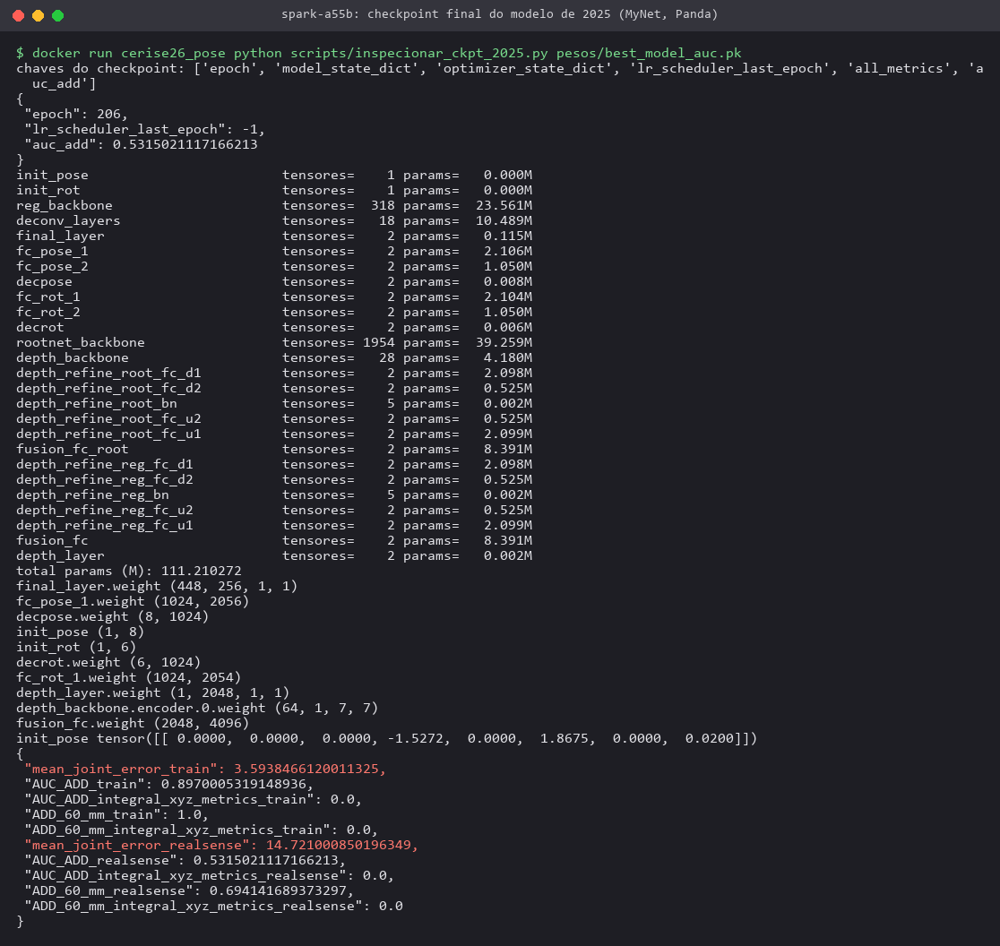

## 4.X.3 Metodologia: adaptação do modelo de 2025 ao servo6dof

### Porte do código para o DGX Spark

O código de 2025 (repositório HPE adaptado e variante MyNet) foi escrito para o Google Colab (caminhos fixos em
`/content/drive`, `torchnet`, `pyrender`, `pytorch3d`, CUDA 11). Ele foi portado para o contêiner
`cerise26_pose` (PyTorch 2.12 para Blackwell/aarch64) mantendo a arquitetura e os pesos compatíveis:
os módulos `full_net.py`, `depth_net.py`, `depth_extractor.py`, backbones ResNet-50/HRNet-W32, camada integral e
Depth Anything V2 foram copiados para `hpe2025/`, com alterações mínimas marcadas como `[porte 2026]` (caminhos
relativos, import ausente do `DepthFeatureExtractor`, pose inicial e robô injetados). A atenção do DINOv2 passou a
usar `scaled_dot_product_attention` (mesma operação matemática; 2,7× mais rápida e com metade da memória no GB10)
e os backbones convolucionais passaram a rodar em precisão mista bf16 com `channels_last` (2,6× mais rápido no
passo de treino medido), mantendo em fp32 a camada integral, a regressão, a cinemática direta e as perdas.
O código rodou no aarch64/GB10 sem necessidade de reimplementação.

Durante o porte foram encontrados e corrigidos dois problemas do código de 2025: (i) na variante MyNet, a
profundidade da raiz era calculada **depois** da camada integral, que recebia `root_trans = 0`; assim, os keypoints
3D do ramo integral não incluíam a profundidade da raiz (por isso as métricas "integral_xyz" de 2025 ficavam
zeradas e as perdas do ramo integral estavam desligadas na configuração final). A ordem do HPE original foi
restaurada (profundidade da raiz → camada integral), o que permitiu reativar essas perdas; (ii) o laço de treino
chamava `optimizer.step()` duas vezes por iteração. Os pesos de perda passaram a ser os do estágio completo
sintético de 2025 (`configs/panda/full.yaml` do HPE: profundidade 10, keypoints 2D/3D da cinemática e do ramo
integral 10, ângulos/rotação/translação/UV 1).

### Configuração do robô servo6dof

- **URDF:** gerado com `xacro` a partir do `servo6dof.urdf.xacro` original (cópia do pacote), dentro da imagem
  ROS 2 `servo6dof:humble` (contêiner `cerise26_pose_xacro`). A cadeia cinemática usada é
  `world → base_link → joint_1 … joint_5 → base_garra`.
- **Keypoints (7):** origem da base, origens dos frames filhos de `joint_1` a `joint_5` e o ponto central da garra
  (média das origens dos pivôs das pinças com a garra em `joint_6 = 0`, fixo no frame de `joint_5`). O número de
  keypoints coincide com o do Panda (7), o que permitiu reaproveitar também a camada final dos mapas de calor.
- **Juntas estimadas:** `joint_1` a `joint_5` (a garra `joint_6` não é estimada).
- **Keypoint de referência (raiz):** junta 3 (cotovelo), como o `reference_keypoint_id = 3` usado com o Panda.
- A cinemática direta do `URDFRobot` de 2025 (urdfpytorch + caminhos do Panda) foi substituída por uma
  cinemática direta diferenciável da cadeia do servo6dof (`hpe2025/robot_servo6dof.py`), com a mesma interface.
- Como o servo6dof tem cerca de 2,0 m de alcance do ombro ao centro da garra (≈2,4× o Panda, 0,855 m) e 2,6 m de
  altura com o braço estendido, a faixa de profundidade relativa dos mapas de calor 3D (`bbox_3d_shape`) foi
  ampliada de 1,3 m para 3,0 m.

### Geometria das câmeras e verificação

As poses das câmeras foram lidas do mundo `estudio_hd.sdf` (`camera_frontal`: 3,2 0,4 1,6 / rpy 0 0,215 π;
`camera_diagonal`: 2,6 2,6 2,4 / rpy 0 0,414 −2,439; o `<link>` e os `<sensor>` não têm pose própria), convertidas
da convenção Gazebo (câmera olhando ao longo de +X, Z para cima) para o frame ótico (Z para frente, Y para baixo).
Os intrínsecos decorrem do HFOV de 1,0472 rad em 1280×720: fx = fy = 640/tan(0,5236) ≈ 1108,5, cx = 640, cy = 360.
O robô é instanciado na origem do mundo com z = 0. A profundidade do dataset está em milímetros (uint16), convertida
pelo script de captura a partir do `32FC1` em metros.

A geometria foi verificada projetando os keypoints calculados por cinemática direta (com os ângulos reais de cada
JSON) sobre as imagens (Figura X.2). Numa amostra de 300 poses, 99,9% (frontal) e 99,6% (diagonal) dos keypoints
que caem dentro do quadro estão sobre a máscara de segmentação do robô, e a profundidade do keypoint fica atrás da
superfície visível (mediana de 83 mm e 125 mm), coerente com os keypoints internos às articulações.

### Conversão do dataset

O conversor (`scripts/converter_dataset.py`) gera, para cada pose e câmera, os keypoints 3D no frame da câmera,
os keypoints 2D, a matriz K, a transformação câmera←base e os ângulos. A divisão treino/validação/teste é feita
**por id de pose** (as duas câmeras de uma pose ficam sempre no mesmo subconjunto), 80/10/10, com semente fixa
(2026) sobre os ids planejados 1–5000. Em vez do recorte pela caixa dos keypoints verdadeiros usado no protocolo
DREAM de 2025 (que usa informação do gabarito também no teste), foi usado um **recorte quadrado fixo por câmera**,
calculado apenas com o conjunto de treino e limitado à área da imagem, redimensionado para 256×256; a mesma janela
é usada em treino, teste e inferência, sem acesso ao gabarito. A profundidade relativa do Depth Anything V2
(ViT-L, pesos oficiais do Hugging Face `depth-anything/Depth-Anything-V2-Large`) foi pré-calculada para cada
recorte (Figura X.3).

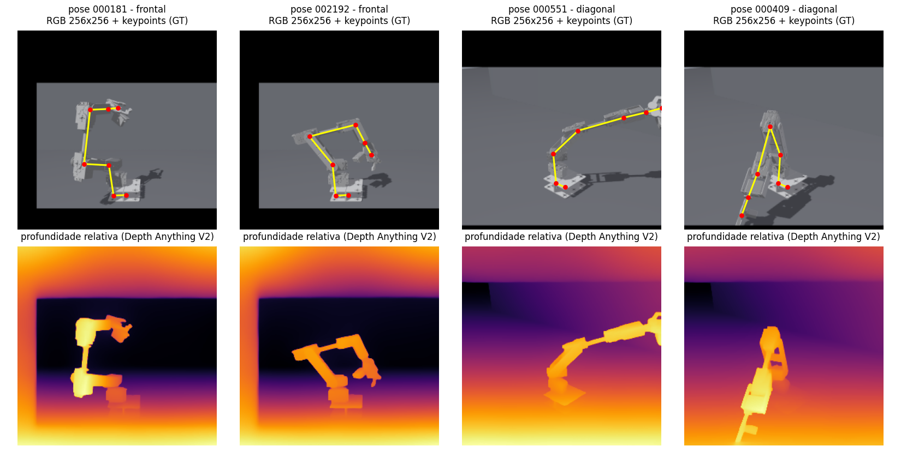

### Treinamento

Foram seguidas as etapas da metodologia de 2025 aplicáveis a dados sintéticos rotulados:

1. **Etapa 1 — DepthNet** (perda L1 da profundidade da raiz, taxa 1e-4, lote 32, 5 épocas);
2. **Etapa 2 — modelo completo** carregando a DepthNet da etapa 1 (taxa 1e-4 com decaimento exponencial 0,9 por
   época a partir da 3ª, lote 32, corte de gradiente 5, augmentations de 2025: *color jitter*, oclusão por ruído,
   nitidez, contraste, brilho e saturação). Perdas: ângulos (MSE, peso 1), rotação 6D (MSE, 1), translação (1),
   profundidade (10), UV da raiz (1), keypoints 3D e 2D da cinemática direta (10 cada) e do ramo integral (10 cada).
3. A etapa 3 de 2025 (autossupervisionada com imagens reais não rotuladas) **não se aplica**, pois ainda não há
   imagens reais do servo6dof; fica como trabalho futuro com o braço físico.

Duas inicializações foram comparadas:

- **Transferência (modelo de 2025):** todos os tensores do modelo de 2025 (Panda) cujas formas casam foram
  carregados — 98,1% (109,1 M de 111,2 M) dos parâmetros; apenas a primeira camada e a saída do regressor de juntas (8 → 5 juntas)
  foram reinicializadas. Na etapa 1, 100% dos parâmetros da DepthNet vieram do modelo de 2025.
- **Baseline (ImageNet):** ResNet-50 (torchvision) e HRNet-W32 (arquivo oficial) pré-treinados no ImageNet, demais
  camadas aleatórias.

### Protocolo de avaliação (Atividade 9)

Todas as métricas foram medidas no **conjunto de teste** (500 poses × 2 câmeras = 1000 imagens, nunca vistas no
treino nem usadas para escolher o checkpoint, que foi selecionado pela validação):

- **MAE por junta** (graus) entre os ângulos estimados e os reais (`juntas_reais` do JSON);
- **erro 3D dos keypoints** no frame da câmera (média e mediana, mm);
- **ADD/acurácia por limiar:** fração de imagens cujo erro 3D médio dos 7 keypoints é ≤ t; **acurácia@60 mm** é a
  mesma métrica da Tabela I do relatório de 2025, e o **AUC-ADD** integra a curva de 0 a 100 mm (mesma
  implementação do código de 2025, `lib/utils/metrics.py`);
- **PCK 2D** a 5/10/20 px na imagem original 1280×720 (por keypoint visível; também por imagem, como em 2025);
- **generalização entre câmeras:** modelo treinado só com a câmera frontal e testado nas duas câmeras;
- **robustez:** perturbações aplicadas à imagem de entrada do modelo (recorte 256×256), com a profundidade do
  Depth Anything V2 **recalculada** sobre a imagem perturbada (pipeline completo), num subconjunto fixo de 400
  imagens do teste: ruído gaussiano (σ = 0,02–0,20), desfoque de movimento horizontal (3–15 px), brilho
  (×0,4–1,8), contraste (×0,3–2,0), oclusão por recorte cinza (10–30% da caixa do robô), compressão JPEG
  (qualidade 50–8) e resolução reduzida (escala 0,5–0,25);
- **latência/FPS** de inferência no GB10 com lote 1 (Depth Anything V2 + HPE, sincronizando a GPU), com a GPU
  compartilhada com os demais serviços do Spark.

## 4.X.4 Resultados — Atividade 8 (execução do modelo no novo dataset)

A aplicação direta do modelo de 2025, sem re-treino, não é possível: a sua saída são as 8 juntas e a cinemática do
Panda, que não correspondem ao servo6dof. Por isso a "aplicação do modelo do ano anterior" foi feita como
transferência de aprendizado — mesma arquitetura e mesmos pesos onde as formas casam, re-treinados no novo dataset.

### Treinamento

A etapa 1 (DepthNet) reduziu o erro de profundidade da raiz na validação para 71 mm com os pesos de 2025 e
70 mm com inicialização ImageNet (Figura X.4), após 5 épocas sobre as 3151 poses de treino já geradas às 03h
(subconjunto do split de treino final; o teste nunca foi usado). Na etapa 2, o modelo de transferência foi treinado por 20 épocas
(62 min no GB10 compartilhado); o baseline ImageNet recebeu 12 épocas (45 min), porque a primeira tentativa de
treiná-lo em paralelo foi interrompida por falta de memória no Spark após o retorno da produção (ver 4.X.7).
A Figura X.5 compara as curvas por época: com os pesos de 2025, o erro 3D na validação cai de 262 mm (época 1)
para 54,1 mm (época 20) e o MAE das juntas de 31,5° para 11,9°. **Na mesma época (12)**, a transferência tem erro 3D
de validação de 65,0 mm contra 83,7 mm do baseline e acurácia@60 mm de 59,1% contra 34,9%, enquanto o MAE das juntas
é semelhante (13,1° contra 12,8°). A perda total de treino da transferência é maior porque inclui o erro do ramo
integral herdado do Panda (0,48 m na época 20, contra 0,14 m no baseline): os mapas de calor 3D de 2025 foram
treinados com outra faixa de profundidade e, na variante MyNet, sem a profundidade da raiz (ver correção em 4.X.3);
a saída do modelo, porém, são os keypoints da cinemática direta, em que a transferência é melhor (0,08 m contra
0,14 m no treino).

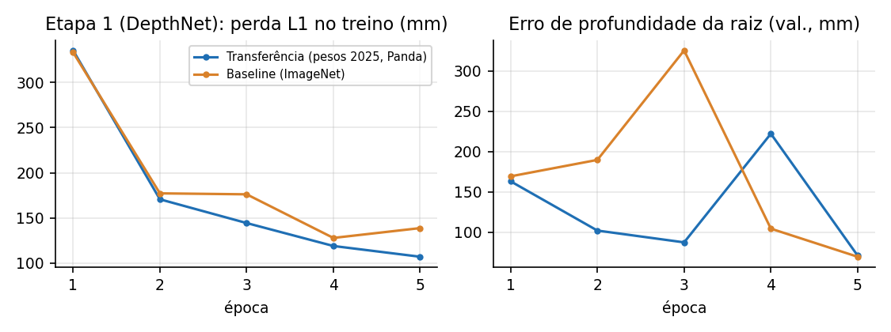

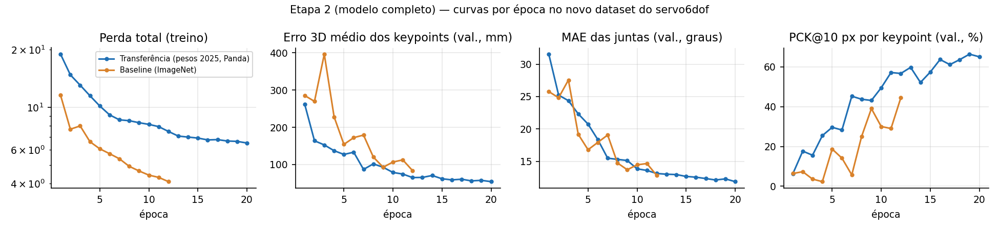

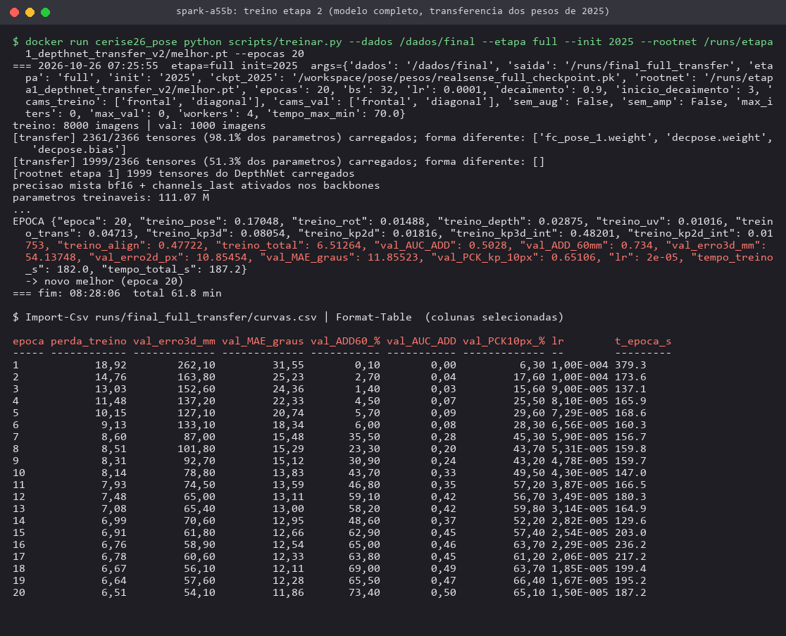

### Resultados quantitativos no conjunto de teste

Tabela X.1 — Resultados no teste (1000 imagens; checkpoint escolhido pela validação).

| Métrica (teste, 500 poses × 2 câmeras) | Transferência (pesos 2025) | Baseline (ImageNet) |
|---|---|---|
| MAE médio das juntas (°) | 12,68 | 13,51 |
| Erro 3D médio dos keypoints (mm) | 58,7 | 88,3 |
| Erro 3D mediano dos keypoints (mm) | 41,1 | 65,7 |
| AUC ADD 0–100 mm | 0,471 | 0,265 |
| Acurácia ADD @60 mm (%) | 68,0 | 32,8 |
| Acurácia ADD @100 mm (%) | 91,2 | 69,7 |
| Acurácia ADD @150 mm (%) ≈ 60 mm × 2,4 (escala do robô) | 96,7 | 90,2 |
| Acurácia ADD @175 mm (%) | 97,8 | 93,7 |
| Erro 2D médio dos keypoints (px) | 12,0 | 17,7 |
| Erro 2D mediano (px) | 7,9 | 11,8 |
| PCK@5 px por keypoint (%) | 30,1 | 19,9 |
| PCK@10 px por keypoint (%) | 61,7 | 43,6 |
| PCK@20 px por keypoint (%) | 87,1 | 71,4 |
| PCK@10 px por imagem (%) (critério 2025) | 57,1 | 26,8 |
| Épocas (melhor checkpoint na validação) | 20 | 12 |

Tabela X.2 — Erro por junta (teste).

| Junta | Transferência MAE (°) | Transferência mediana (°) | Baseline MAE (°) |
|---|---|---|---|
| joint_1 (base) | 4,19 | 2,94 | 7,20 |
| joint_2 (ombro) | 3,04 | 1,89 | 3,87 |
| joint_3 (cotovelo) | 3,91 | 2,54 | 5,41 |
| joint_4 (punho) | 10,52 | 6,64 | 9,25 |
| joint_5 (rotação da garra) | 41,73 | 42,49 | 41,83 |

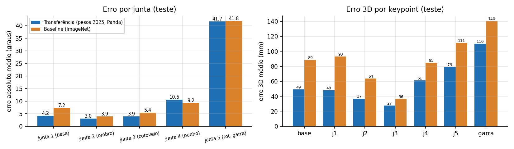

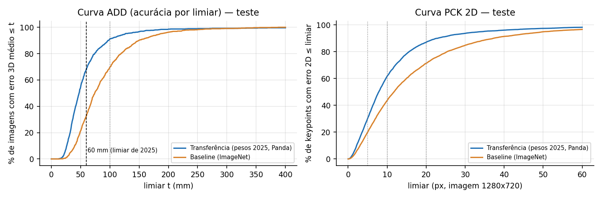

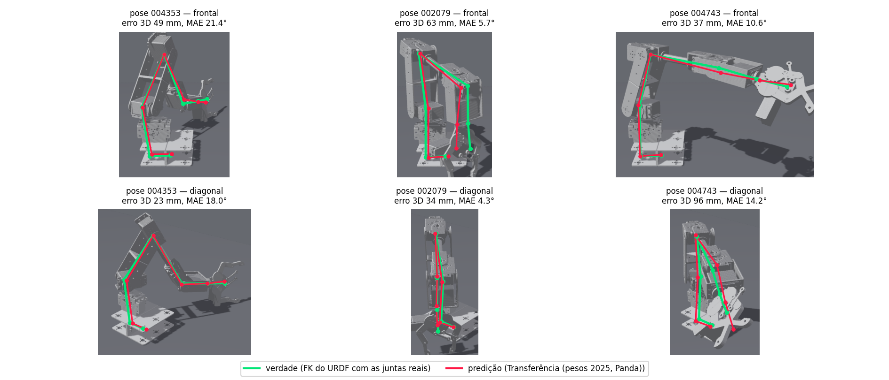

O modelo de 2025 adaptado ao servo6dof atingiu, no teste, **MAE de 12,68°** nas cinco juntas, **erro 3D médio
de 58,7 mm** (mediana 41,1 mm) e **acurácia@60 mm de 68,0%** (AUC-ADD 0,471). As juntas 1 a 3 (base, ombro e
cotovelo) são estimadas com MAE entre 3,0° e 4,2°, e a junta 4 (punho) com 10,5°. A junta 5 (rotação da garra em
torno do eixo do antebraço) tem MAE de 41,7°, próximo de prever sempre o valor médio (≈42° para ângulos uniformes em
±85°): como o keypoint da garra fica sobre o eixo de rotação dessa junta (desvio de 1 cm), ela praticamente não
altera nenhum keypoint e as perdas geométricas não a supervisionam; só a perda direta de ângulo atua. Excluindo a
junta 5, o MAE médio das juntas 1–4 é 5,4°.

**Transferência × baseline.** Em relação à inicialização ImageNet (12 épocas), o modelo com os pesos de 2025 reduziu
o erro 3D médio de 88,3 para 58,7 mm (−34%), elevou a acurácia@60 mm de 32,8% para 68,0% e o PCK@10 px de 43,6% para
61,7%; o MAE das juntas melhorou menos (13,51° → 12,68°), com ganho nas juntas 1–3 e leve perda na junta 4. Como o
baseline teve menos épocas, a comparação de mesmo orçamento é a da validação na época 12 (65,0 mm × 83,7 mm),
que confirma a vantagem da transferência na precisão 3D. O ganho vem sobretudo do ramo de profundidade (DepthNet +
fusão com o Depth Anything V2) e dos extratores pré-treinados em imagens de braço robótico, já que a cinemática e o
número de juntas mudaram.

**Comparação com 2025.** A Tabela X.3 coloca lado a lado a acurácia@60 mm de 2025 (robô Panda, dados reais
DREAM/RealSense) e a de 2026 (servo6dof, dados sintéticos). Os números **não são diretamente comparáveis**: o
servo6dof tem cerca de 2,4× o alcance do Panda (≈2,0 m do ombro ao centro da garra, contra 0,855 m), de modo que
60 mm equivalem a ~3% do alcance (contra ~7% no Panda); as câmeras estão a 3,3–4,3 m do robô; o recorte de entrada é
fixo (sem usar o gabarito) e os dados são sintéticos. Com o limiar proporcional ao tamanho (60 mm × 2,4 ≈ 142 mm), a
acurácia@150 mm é de 96,7%.

Tabela X.3 — Acurácia@60 mm: 2025 (Panda) × 2026 (servo6dof). Robôs, escalas, câmeras e dados diferentes.

| Modelo | Robô / dados | Acurácia@60 mm (%) | AUC-ADD (0–100 mm) | MAE juntas (°) | Fonte |
|---|---|---|---|---|---|
| RoboPose | Panda / DREAM real (RealSense) | 74,3 | — | — | relatório dez/2025 |
| HPRE | Panda / DREAM real (RealSense) | 75,2 | — | — | relatório dez/2025 |
| Modelo de 2025 (HPE + DA-V2) | Panda / DREAM real (RealSense) | 75,4 | 0,547 | 11,58 | `results_formatado_complete.csv`, época 355 |
| Modelo de 2025 + transferência | servo6dof / sintético 2026 (teste) | 68,0 | 0,471 | 12,68 | medido nesta atividade |
| Mesma arquitetura, baseline ImageNet | servo6dof / sintético 2026 (teste) | 32,8 | 0,265 | 13,51 | medido nesta atividade |

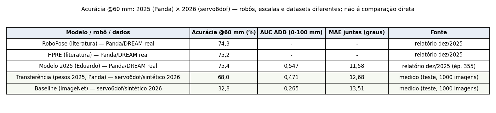

## 4.X.5 Resultados — Atividade 9 (precisão e robustez)

### Generalização entre câmeras

Tabela X.4 — Desempenho por câmera de teste.

| Câmera de teste | Modelo | MAE (°) | Erro 3D médio (mm) | AUC ADD | ADD@60 mm (%) | PCK@10 px (%) |
|---|---|---|---|---|---|---|
| frontal | Transferência (2 câmeras) | 12,70 | 57,4 | 0,486 | 69,0 | 58,8 |
| diagonal | Transferência (2 câmeras) | 12,65 | 60,0 | 0,457 | 67,0 | 64,5 |
| frontal | Baseline (2 câmeras) | 13,56 | 84,3 | 0,272 | 31,4 | 39,7 |
| diagonal | Baseline (2 câmeras) | 13,47 | 92,2 | 0,258 | 34,2 | 47,4 |
| frontal | Treino só frontal (xcam) | 23,08 | 140,4 | 0,084 | 8,6 | 22,2 |
| diagonal | Treino só frontal (xcam) | 32,57 | 418,5 | 0,000 | 0,0 | 3,5 |

Com as duas câmeras no treino, o desempenho é equivalente nas duas vistas (MAE 12,70° frontal e 12,65° diagonal).
O modelo treinado **só com a câmera frontal** (experimento menor: 3151 poses de treino disponíveis às 03h, 10 épocas,
melhor na época 6) degrada fortemente na câmera não vista: o erro 3D vai de 140 mm (frontal) para 419 mm
(diagonal) e a acurácia@60 mm cai a 0%. O modelo aprende implicitamente a relação câmera–robô (rotação e
profundidade da raiz) da vista de treino; generalizar para câmeras novas exige variar a pose da câmera nos dados
de treino (randomização de domínio) ou fornecer a extrínseca como entrada.

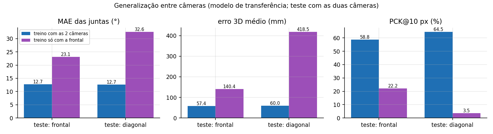

### Robustez

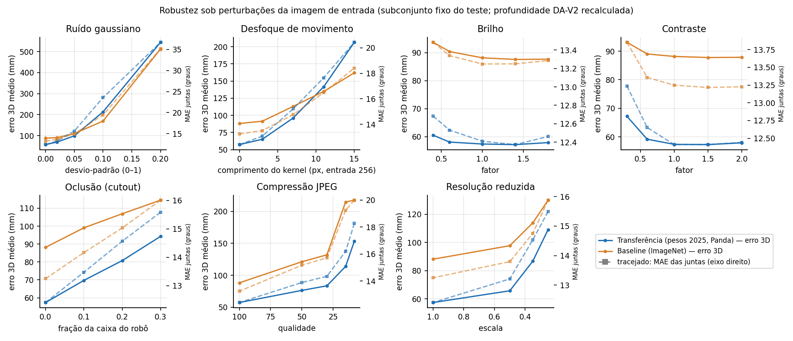

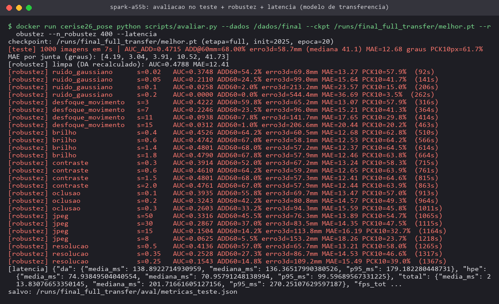

Tabela X.5 — Robustez (subconjunto fixo de 400 imagens do teste; profundidade DA-V2 recalculada sobre a imagem perturbada).

| Perturbação | Severidade | Transf.: erro 3D (mm) | Transf.: MAE (°) | Transf.: PCK@10 px (%) | Baseline: erro 3D (mm) | Baseline: MAE (°) |
|---|---|---|---|---|---|---|
| sem perturbação | — | 57,4 | 12,41 | 64,7 | 88,2 | 13,25 |
| Ruído gaussiano (σ) | 0,02 | 69,8 | 13,27 | 57,9 | 90,6 | 13,64 |
| Ruído gaussiano (σ) | 0,05 | 99,0 | 15,64 | 41,7 | 109,7 | 14,97 |
| Ruído gaussiano (σ) | 0,1 | 213,2 | 23,57 | 15,0 | 169,7 | 19,46 |
| Ruído gaussiano (σ) | 0,2 | 544,4 | 36,69 | 3,5 | 512,4 | 35,15 |
| Desfoque de movimento (px) | 3 | 65,2 | 13,07 | 57,9 | 91,5 | 13,51 |
| Desfoque de movimento (px) | 7 | 96,0 | 15,21 | 41,3 | 113,0 | 14,76 |
| Desfoque de movimento (px) | 11 | 141,7 | 17,65 | 29,8 | 134,8 | 16,48 |
| Desfoque de movimento (px) | 15 | 206,6 | 20,44 | 20,2 | 162,1 | 18,42 |
| Brilho (×) | 0,4 | 60,5 | 12,68 | 62,8 | 93,7 | 13,48 |
| Brilho (×) | 0,6 | 58,1 | 12,53 | 64,2 | 90,4 | 13,34 |
| Brilho (×) | 1,4 | 57,2 | 12,37 | 64,5 | 87,6 | 13,25 |
| Brilho (×) | 1,8 | 57,9 | 12,46 | 63,8 | 87,7 | 13,29 |
| Contraste (×) | 0,3 | 67,2 | 13,24 | 58,3 | 93,1 | 13,85 |
| Contraste (×) | 0,6 | 59,2 | 12,65 | 63,9 | 89,0 | 13,36 |
| Contraste (×) | 1,5 | 57,3 | 12,41 | 64,6 | 87,8 | 13,22 |
| Contraste (×) | 2,0 | 57,9 | 12,44 | 63,9 | 87,9 | 13,23 |
| Oclusão (fração da caixa) | 0,1 | 69,7 | 13,47 | 57,0 | 99,1 | 14,16 |
| Oclusão (fração da caixa) | 0,2 | 80,8 | 14,57 | 49,3 | 106,9 | 15,03 |
| Oclusão (fração da caixa) | 0,3 | 94,3 | 15,59 | 45,8 | 114,5 | 16,01 |
| JPEG (qualidade) | 50 | 76,3 | 13,89 | 54,7 | 121,1 | 15,17 |
| JPEG (qualidade) | 30 | 83,5 | 14,35 | 47,5 | 132,0 | 15,72 |
| JPEG (qualidade) | 15 | 113,8 | 16,19 | 32,7 | 214,6 | 19,23 |
| JPEG (qualidade) | 8 | 153,2 | 18,26 | 23,7 | 217,4 | 19,99 |
| Resolução (escala) | 0,5 | 65,7 | 13,21 | 58,0 | 97,7 | 13,80 |
| Resolução (escala) | 0,35 | 86,7 | 14,53 | 46,6 | 113,9 | 14,75 |
| Resolução (escala) | 0,25 | 109,2 | 15,49 | 39,0 | 130,0 | 15,88 |

O modelo é robusto a variações de **brilho e contraste** (erro 3D ≤ 68 mm mesmo com brilho ×0,4 ou contraste ×0,3),
o que é coerente com as augmentations fotométricas usadas no treino de 2025. É **sensível a perturbações de alta
frequência**: ruído gaussiano com σ = 0,05 já eleva o erro 3D de 57 para 99 mm (σ = 0,1 → 213 mm), o desfoque de
movimento de 7 px para 96 mm e a compressão JPEG com qualidade 30 para 84 mm. A oclusão de 30% da caixa do robô
eleva o erro para 94 mm (acurácia@60 mm de 33%), e reduzir a resolução para 25% leva a 109 mm. Em todas as
perturbações, o MAE das juntas degrada mais devagar que o erro 3D (12,4° → 15,6° com oclusão de 30%), porque a
regressão de ângulos depende de características globais, enquanto o erro 3D acumula também os erros de
profundidade e rotação da raiz. O baseline ImageNet parte de um erro maior, mas degrada menos sob ruído e desfoque
fortes (σ = 0,1: 170 mm contra 213 mm; desfoque de 15 px: 162 mm contra 207 mm), sugerindo que os pesos de 2025
deixam o modelo mais dependente de detalhes finos da imagem.

### Latência no GB10

Tabela X.6 — Latência de inferência no GB10 (lote 1, GPU compartilhada com a produção e outras frentes).

| Medida | Média (ms) | Mediana (ms) | p95 (ms) | FPS |
|---|---|---|---|---|
| `PosePredictor.predict` ponta a ponta (imagem 1280×720 → juntas), 100 chamadas | 162,5 | 170,1 | 174,1 | 6,15 |
| — Depth Anything V2 ViT-L (entrada 518 px, fp16)¹ | 138,9 | 136,4 | 179,2 | — |
| — HPE (DepthNet + integral + regressão + FK)¹ | 74,9 | 71,0 | 99,6 | 13,34 |

¹ Decomposição medida em outro momento, com o treino do baseline rodando em paralelo na mesma GPU (total 213,8 ms).
Memória de GPU de pico do `PosePredictor` no lote 1: 2,94 GB. O Depth Anything V2 ViT-L domina o custo (~65%);
a troca por ViT-S/ViT-B ou a execução em TensorRT são as alternativas para tempo real.

## 4.X.6 Módulo de inferência para o gêmeo digital (Objetivo 4)

O modelo final foi empacotado em `~/cerise2026/pose/inferencia/modelo/pose_servo6dof.pt` (pesos + hiperparâmetros
+ recortes e intrínsecos das câmeras) e exposto pela classe `PosePredictor` (`~/cerise2026/pose/inferencia/predict.py`):
`predict(rgb_uint8_HxWx3, camera='frontal'|'diagonal')` devolve os ângulos `joint_1…joint_5` (rad), os 7 keypoints
2D/3D e a latência. A documentação está em `INFERENCIA.md` e o estado em `~/cerise2026/pose/READY.json`, consumido
pela frente do gêmeo digital. O uso de memória de GPU no lote 1 foi de 2,94 GB.

## 4.X.7 Operação no Spark de produção

O treino final só foi iniciado depois que o contêiner de geração (`braco_gen`) terminou e a produção voltou.
A geração terminou às 04:19:47 com as 5000 poses, após uma segunda ronda que refez ~250 poses perdidas (pelos
logs, os workers que terminavam a sua parte executavam `pkill -f "ign gazebo"`, derrubando os simuladores dos
demais, que passavam a registrar "nenhuma imagem recebida"). O finalizador `~/braco/finalizar.sh`
falhou ao religar a produção por usar um caminho inexistente (`~/braco/dataset_run_restore.sh`; o script correto é
`~/dataset_run_restore.sh`), mas a produção foi religada manualmente às 04:20:57; às 04:25 `vllm-server`,
`vllm-embed`, `qdrant`, `vania-brain` e `ollama` respondiam HTTP 200 e o `vllm-stt` (reiniciado às 04:25:39) às 04:27
(Figura X.15), sem necessidade de intervenção desta frente; às 06:35 todos continuavam saudáveis. Durante a geração, todos os jobs desta frente ficaram abaixo do teto de 14 GB de GPU
(DepthNet 5 GB, modelo completo 9,3 GB, DA-V2 7,6 GB); após o retorno da produção, a regra de manter ≥ 10 GB
disponíveis foi seguida, e o baseline foi re-executado sozinho depois de uma primeira tentativa em paralelo ter sido
interrompida por pressão de memória.

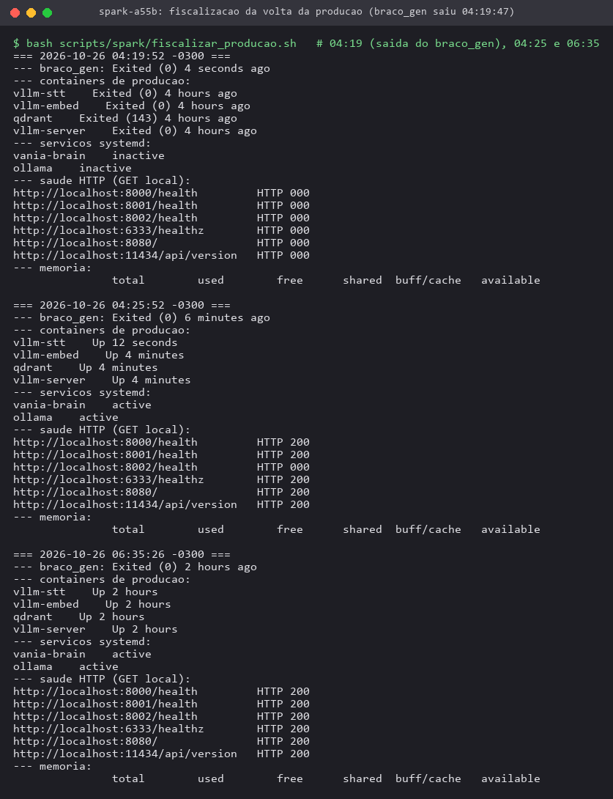

## 4.X.8 Limitações

- Dados **apenas sintéticos** e câmeras fixas: a etapa autossupervisionada com dados reais de 2025 não pôde ser
  aplicada; o desempenho em imagens reais do braço físico não foi medido.
- A junta 5 não é observável pelos keypoints escolhidos (keypoint da garra sobre o eixo); a garra (`joint_6`) não é
  estimada.
- Orçamento de treino curto (20 épocas, ~1 h) em GPU compartilhada; o baseline recebeu menos épocas que a
  transferência, por isso a comparação justa entre inicializações é feita por época (Figura X.5).
- Os pesos exatos da época 355 do modelo de 2025 (75,4%) não existem; foi usado o estado final do mesmo treino.
- A latência foi medida com a GPU compartilhada com a produção e outras frentes (valores pessimistas).

## 4.X.9 Próximos passos

- Adicionar keypoints fora do eixo da junta 5 (pontas das pinças) e estimar a abertura da garra.
- Randomizar poses de câmera, iluminação, fundo e texturas na geração (Atividade 7) e incluir ruído/blur/JPEG nas
  augmentations, para melhorar a generalização entre câmeras e a robustez.
- Capturar imagens reais do braço físico e aplicar a etapa autossupervisionada de 2025 (sim2real).
- Otimizar a latência (DA-V2 Small/Base, TensorRT, entrada 256 px para o DA) para uso em tempo real no gêmeo digital.

**Código e evidências:** https://github.com/EduardoCaixeta/cerise-2026-pose-servo6dof — métricas em `resultados/`
(`metricas_teste_*.json`, `curvas_*.csv`, `predicoes_teste_*.npz`), figuras em `evidencias/`.
